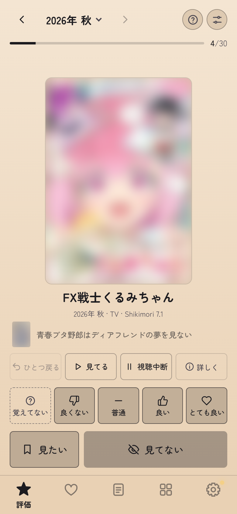
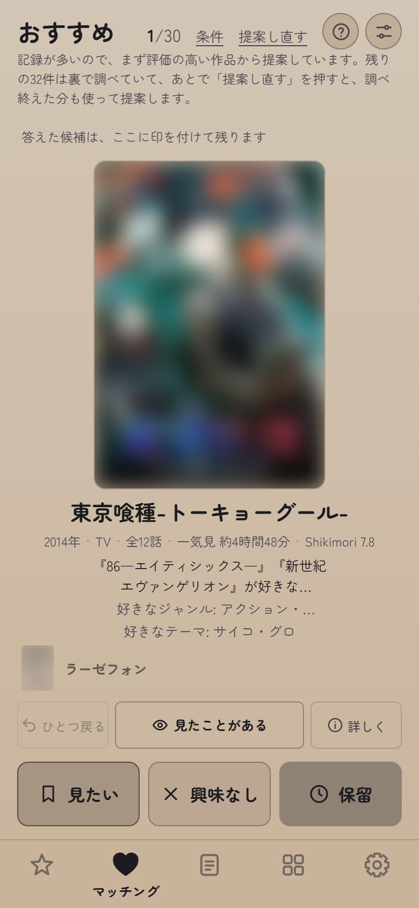
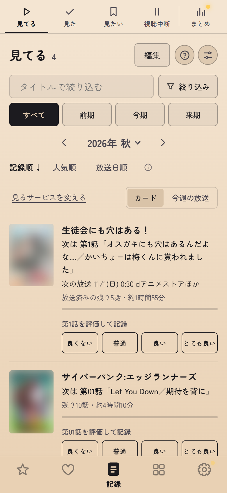
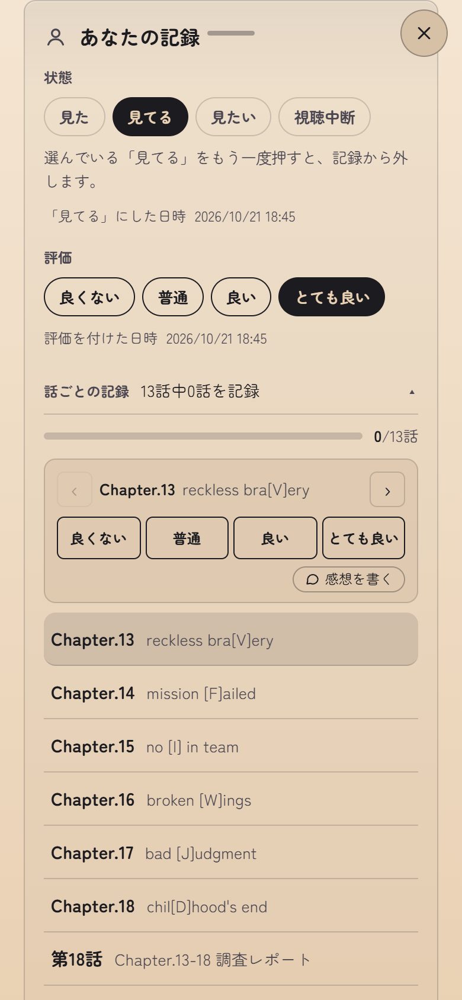
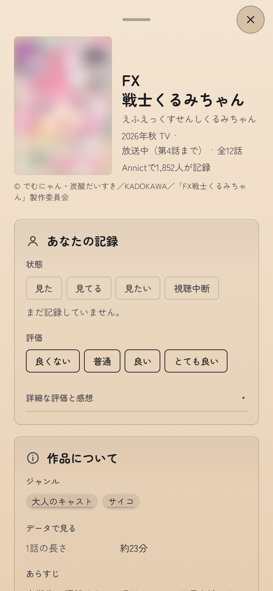
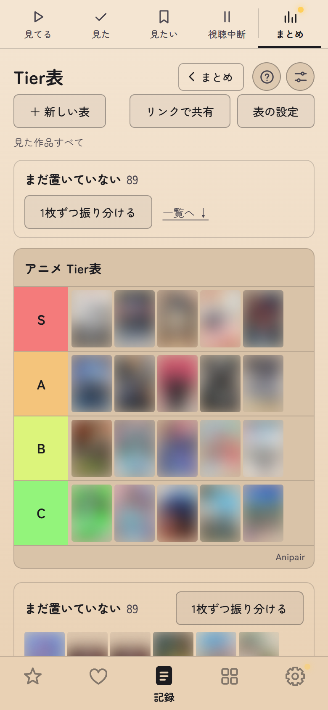
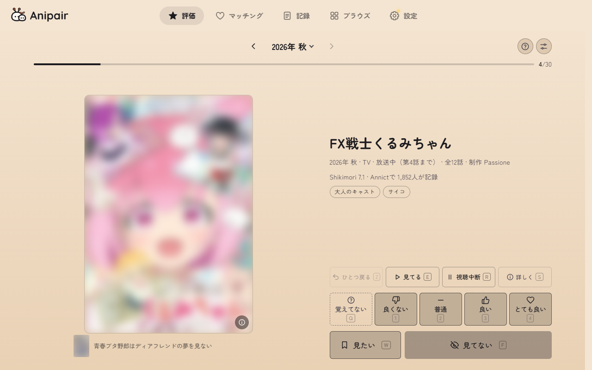
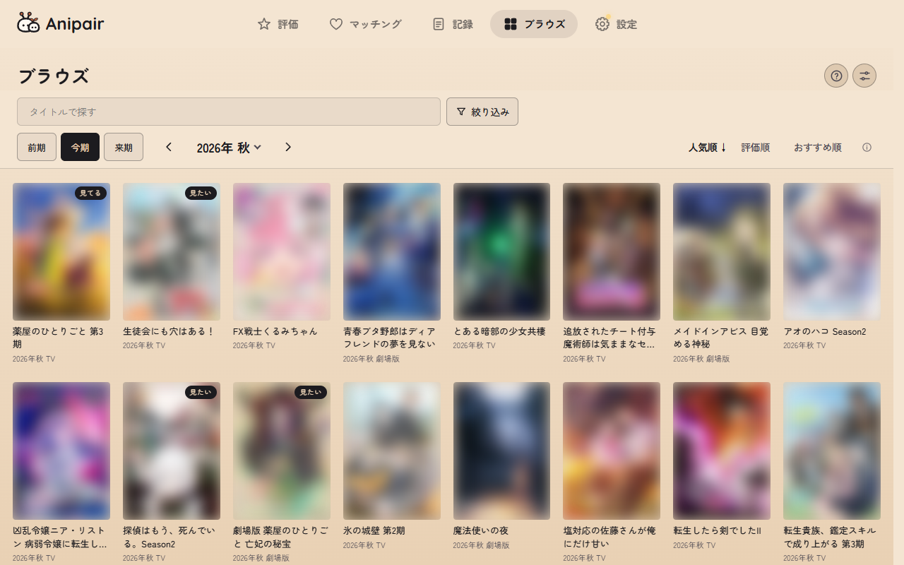
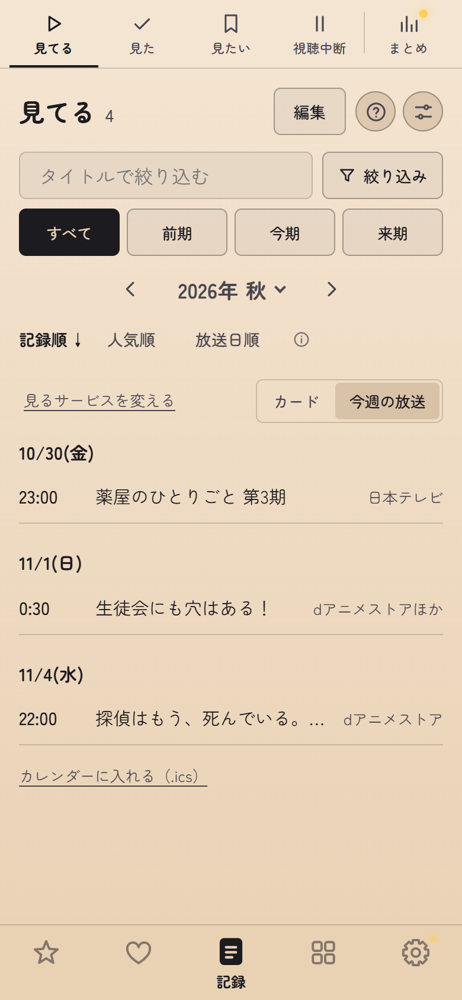

<h1 align="center">
  <br>
  Anipair
</h1>

<p align="center"><strong>あなたの「好き」と、次の「好き」をつなぐ。</strong></p>

<p align="center">
  <a href="https://anipair.com/">公開版を開く</a> ・
  <a href="CHANGELOG.md">更新履歴</a> ・
  <a href="https://anipair.com/privacy.html">プライバシーポリシー</a>
</p>

[Annict](https://annict.com/)の視聴記録をタップだけで付けていくためのWebアプリです。見たアニメを1タップで評価でき、その評価から好みを推定して、まだ見ていない作品を提案します。記録はすべて自分のAnnictに保存されます。

Annictの非公式の個人開発アプリで、Annictの運営とは関係がありません。

## 使い方

使い始めるのに必要なのは**Annictのアカウント**だけです。ふだんは2〜4を行き来しながら使います。

### 1. Annictでログインする

[公開版](https://anipair.com/)を開き、「Annictでログイン」を押します。これまでAnnictに付けた記録がそのまま読み込まれます。

### 2. 見た作品を評価する（評価）

<table><tr>
<td width="200"></td>
<td valign="top">

クールごとの人気作が1枚ずつ出てきます。下のボタンで答えると、次の作品に進みます。

- 見た作品: 「良くない」から「とても良い」までの4段階
- 見ていない作品: 「見てない」
- 気になる作品: 「見たい」

間違えたら「ひとつ戻る」で取り消せます。上の線はそのクールの人気作のうち答えた数を表します。矢印でクールをさかのぼっていくと、昔見た作品の記録がたまっていきます。

</td>
</tr></table>

### 3. 次に見る作品を提案してもらう（マッチング）

<table><tr>
<td width="200"></td>
<td valign="top">

2で付けた評価から好みを調べて、まだ記録していない作品を、おすすめの理由と一緒に1枚ずつ出します。

- 気になる作品: 「見たい」（Annictの見たいリストに入ります）
- 興味がない作品: 「興味なし」
- 今は決めない作品: 「保留」

評価した作品が増えるほど、提案は好みに寄っていきます。形式（TV・劇場版など）と放送年でも絞れます。

</td>
</tr></table>

### 4. 見ている作品を1話ずつ記録する（記録）

<table><tr>
<td width="200"></td>
<td valign="top">

記録の画面は「見てる」の一覧から始まります。カードに次の話が出ていて、4段階の評価を押すと、その話をその場でAnnictに記録できます。

一覧の上で見るサービス（配信・地上波の地域など）を選ぶと、放送中の作品に次の放送日が出ます。

「今週の放送」に切り替えると、これから7日の放送を日ごとに見られ、カレンダーにも入れられます。

</td>
</tr></table>

### 5. 話ごとに感想を残す（作品の詳細）

<table><tr>
<td width="200"></td>
<td valign="top">

作品の表紙を押すと詳細が開きます。「話ごとの記録」を開くと、話を4段階で評価して記録できます。評価を押すたびに次の話が出るので、続けて押せます。

「感想を書く」で、話ごとの感想も残せます。評価と感想は別々に送れるので、感想だけの記録もできます。

最終話まで記録すると、作品全体の評価を付けて「見た」にできます。

</td>
</tr></table>

### 6. 作品を探す（ブラウズ）

<table><tr>
<td width="200"></td>
<td valign="top">

クールごとの一覧とタイトルの検索（英語やローマ字の題名でも）で、作品を探せます。人気順・評価順・おすすめ順に並べ替えられます。絞り込みで期間とジャンルや制作会社を選ぶと、その期間の全作品から探します。

作品の詳細ではあらすじ・キャスト・スタッフ・関連作品を読めます。

- 声優・スタッフ・制作会社の名前を押すと、その人や会社が関わった作品が並びます
- ジャンルを押すと、そのジャンルの人気作が並びます

どちらからも次の作品をたどっていけます。

</td>
</tr></table>

### 7. ふり返る（まとめ）

<table><tr>
<td width="200"></td>
<td valign="top">

記録の画面の「まとめ」に、次の4つがあります。

- 傾向: 評価の分布、世間と比べた甘口・辛口、ジャンルの好み、よく見る声優や監督などの図
- ふり返り: 1年に見た本数と、よかった作品
- 実績: クールの踏破などで手に入る称号。プロフィールに掲げられます
- Tier表: 見た作品を、Annictの評価の順に仮に並べた表から始めて、好きな段に動かします。見たい作品・今期のアニメ・ジャンル・制作会社で、別の表も作れます

傾向・ふり返り・称号は画像にして、Tier表はリンクにして共有できます。

</td>
</tr></table>

### そのほか

- 各画面の右上の「?」を押すと、実際の画面のボタンを1つずつ指しながら使い方を説明します
- 日本語と英語の画面、明るい・暗い表示に対応しています。PCでは記録とブラウズを画面の幅いっぱいに広げ、キーボードだけでも操作できます

<details>
<summary>PCの画面と、今週の放送の画面</summary>







</details>

## 記録の置き場所

Anipairは利用者の記録やトークンを置く運営サーバーを持ちません。

| データ | 置き場所 |
|---|---|
| 見た・見たい・評価などの記録 | あなたのAnnict |
| 興味なし・保留・見てない・見たいのメモ・Tier表など、Annictに置けないもの | この端末（GitHubと連携すると、あなたのprivateリポジトリにも） |
| トークン・設定 | この端末だけ |

例外は、利用者が自分から送ったものだけです。問い合わせの内容と、リンクで共有したTier表（題名・段の名前・作品の並び）は、Anipairが受け取ります。

どの画面が開かれたかは、Cookieを使わない[Vercel Web Analytics](https://vercel.com/docs/analytics/privacy-policy)で集計しています。

通信先と保存するものは、すべて[プライバシーポリシー](https://anipair.com/privacy.html)に書いてあります。

## GitHub連携（任意）

連携しなくても、すべての機能を使えます。自分のGitHubのprivateリポジトリとつなぐと、Annictに置けない記録をPCとスマホで共有でき、作品ごとの記録を毎日自動でバックアップします（変更履歴つき）。連携しない場合も、設定の「ファイルに書き出す」でJSONファイルに保存できます。

<details>
<summary>連携の手順（アプリの設定にも同じ手順があります）</summary>

1. GitHubでprivateリポジトリを作成します（例: `anipair-data`）
2. [Fine-grainedトークン](https://github.com/settings/personal-access-tokens/new)を作成します。Repository accessは手順1のリポジトリだけを選び、PermissionsのContentsを「Read and write」にします
3. 設定の「GitHub連携」にリポジトリ名（`ユーザー名/anipair-data`）とトークンを入力し、「連携する」を押します

</details>

## 質問・不具合・要望

設定の「お問い合わせ」から送れます。GitHubのアカウントは要らず、送った内容は開発者だけが読みます。GitHubを使う方はこのリポジトリの[Issues](https://github.com/manato003/Anipair/issues)からも送れます（こちらは公開されます）。

## 注意

- AnnictのAPIはベータ版で、予告なく変わることがあります。変わると、動かなくなる機能が出るかもしれません
- Annictから読むのは、AnnictのAPIで公開されている情報だけです
- 表紙はShikimoriのポスターを優先し、無ければAnnictのAPIの画像（作品の公式サイトのもの）を出します。画像の権利は各権利者にあります

## 開発

Vite + React + TypeScriptの静的サイトです。サーバーで動く処理はVercelの関数（`api/`）の4つだけです（ログインの受け渡し・Shikimoriへの中継・問い合わせの受け付け・Tier表の共有のリンク）。

```
npm install
npm run dev      # http://localhost:5173
npm run lint
npm run typecheck
npm test
npm run build
```

<details>
<summary>ローカルでのログインと、自分で公開する方法</summary>

- 個人用アクセストークンで使う: ローカルでは「Annictでログイン」のボタンが出ません（ログインの関数が動かないため）。最初の画面の「開発者向け: 個人用アクセストークンで使う」を開き、Annictの[アプリケーションの設定](https://annict.com/settings/apps)で作った個人用アクセストークン（権限は「読み込み + 書き込み」）を貼ってください
- 「Annictでログイン」をローカルで試す: Annictに[アプリケーションを登録](https://annict.com/oauth/applications)し（スコープは「読み込み + 書き込み」、リダイレクトURIは`http://localhost:3000/`）、`.env.example`を見て`.env.local`に値を入れてから、`vercel dev`で起動します
- 自分で公開する: このリポジトリをフォークしてVercelにつなぎ、`.env.example`にあるログインの4つの環境変数を設定します（`ANNICT_CLIENT_SECRET`などに`VITE_`を付けないでください。付けると公開のJSに入ります）。AnnictのアプリケーションのリダイレクトURIには、公開するアドレス（末尾のスラッシュまで）を登録します。問い合わせの受け付けとUpstashの環境変数は任意で、無ければ問い合わせとTier表の共有は使えず、Shikimoriへの中継は控えなしで回数を抑えて動きます

</details>

作りについてはZennに書いています。

- [Annictの記録をタップで付けて、次に見るアニメを理由つきで提案するWebアプリを作った](https://zenn.dev/manato003/articles/anipair-annict-anime-app)
- [公開APIを使わせてもらう側として、負担をかけないクライアント作りで意識したこと](https://zenn.dev/manato003/articles/anipair-gentle-api-client)

## 謝辞

- [Annict](https://annict.com/)：記録の保存先とデータ。ありがとうございます
- [Shikimori](https://shikimori.io/)：作品データの一部（ジャンル・テーマ・似た作品・一部の表紙・参加作品）
- [Wikipedia](https://ja.wikipedia.org/)：作品のあらすじ（CC BY-SA 4.0）
- [Wikidata](https://www.wikidata.org/)：英語の画面の声優・スタッフの英語名など（CC0）

## ライセンス・規約

ソースコードは[MIT](LICENSE)です。ただし、**Anipairの名前とロゴ、キャラクターのアニとペアはMITライセンスの対象外**です（詳しくは[LICENSE](LICENSE)の「例外」）。フォークして公開するときは、名前・ロゴ・キャラクターを差し替えてください。`fonts/`の書体（Zen Maru Gothic）は、SIL Open Font License 1.1です（[fonts/OFL.txt](fonts/OFL.txt)）。

[利用規約](https://anipair.com/terms.html) ・ [プライバシーポリシー](https://anipair.com/privacy.html)
